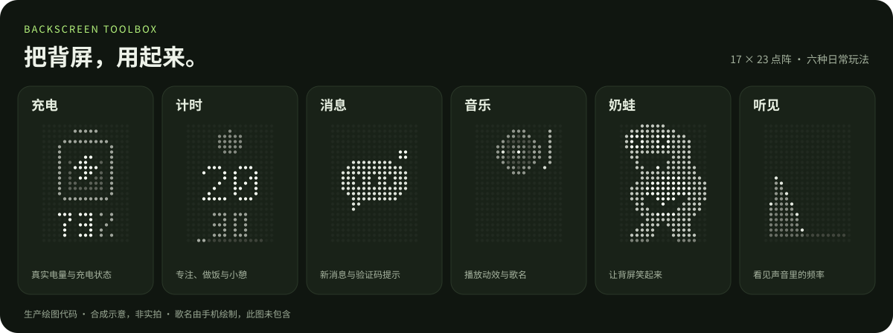
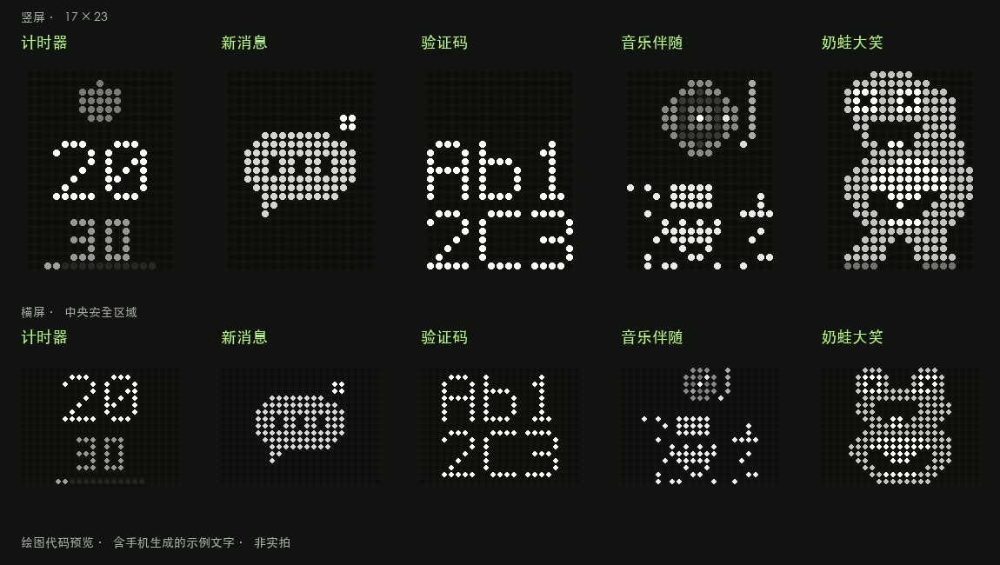

<div align="center">

# STEPX 背屏工具箱

**给 STEPX 的点阵背屏，添上六种日常玩法。**

Backscreen Toolbox · [STEPX Advance](https://github.com/stepx-advance)

[](https://github.com/stepx-advance/backscreen-toolbox/releases/latest)
[](#适用范围)
[](LICENSE)

**[下载 1.1.0 APK](https://github.com/stepx-advance/backscreen-toolbox/releases/download/v1.1.0/backscreen-toolbox-1.1.0.apk)** · [快速开始](#快速开始) · [看动效](#效果预览) · [文档](#文档与开发) · [反馈问题](https://github.com/stepx-advance/backscreen-toolbox/issues/new/choose)

</div>



看充电进度、倒数一杯茶的时间、留意新消息，或者让声音变成一座小小的频谱山。无需 Root 或 Shizuku，应用离线运行，无网络权限。

> **适用范围：STEPX PZ261A / Android 16 / Step AOS 1.0.0.2。** 本项目为非官方工具，其他设备或固件尚未验证。完整记录见 [验证范围](docs/TESTING.md)。

## 六种玩法

| 玩法 | 背屏上能看到什么 |
| --- | --- |
| **充电** | 真实电量，以及充电、满电、旁路、等待和暂停状态。支持横竖屏重排与图标、数字整组过渡。 |
| **计时** | 番茄钟、做饭、泡茶／倒茶、小憩和运动预设；可自定义分秒、暂停、继续，到点显示完成提示并轻震动。 |
| **消息** | 普通消息只提示“有消息”；最新一条包含可识别验证码时，显示来源和完整数字／字母，最多 25 秒后清除。 |
| **音乐** | 播放时显示唱片微动与歌名，暂停后回到原场景。无需麦克风。 |
| **奶蛙** | 手工绘制的“奶蛙大笑”点阵动画，可笑一分钟或持续播放。 |
| **听见** | 麦克风实时驱动的竖屏频谱山形，左低频、右高频，提供三档灵敏度。主动开始，随时停止，不保存声音。 |

## 快速开始

1. **安装**：[下载 APK](https://github.com/stepx-advance/backscreen-toolbox/releases/download/v1.1.0/backscreen-toolbox-1.1.0.apk)，在手机上完成安装确认。校验文件 `SHA256SUMS` 位于同一 [发布页](https://github.com/stepx-advance/backscreen-toolbox/releases/tag/v1.1.0)。
2. **完成清单**：打开应用，按一屏引导开启系统背屏并完成后台运行设置。每项都有红框图解和系统设置入口，具体开关仍需你在系统页面确认。
3. **选一个玩法**：顶部看当前背屏，点击标签或左右滑动切换设置；按需要开始计时、播放奶蛙或开启“听见”。浏览页面不会切换正在运行的任务。

想先看效果，点顶部 **“预览”** 即可；12 秒后自动返回，也可手动结束。计时预览不创建提醒，“听见”预览不打开麦克风。

**从公开版 1.0.0 升级**：直接覆盖安装，包名和签名保持一致，保留设置。新增权限按功能申请，升级不会自动开启麦克风或消息读取。首次安装与旧内部版迁移见 [设置说明](docs/SETUP.md)。

### 权限按需要开启

| 想使用 | 需要完成的设置 |
| --- | --- |
| 基础背屏 | 开启系统背屏；允许电池优化豁免，并在原厂后台管理中核对“允许自启动”和“允许后台运行” |
| 旁路识别 | 可选授权“旁路识别（系统电池通知）”；普通充电显示无需此权限 |
| 计时器 | 按提示允许“闹钟和提醒” |
| 消息／音乐 | 主动启用功能，并独立授权“消息与音乐背屏（可选）” |
| 听见 | 主动开始时允许麦克风；停止后释放，重启或进程重建后不会自动录音 |

通知抽屉里的运行通知可按需关闭，系统“活动应用”仍可能保留运行标识。验证码可单独关闭；开启后可能在锁屏背屏上可见，Android 15+ 遮住验证码时会退回普通消息提示。详见 [权限与隐私](docs/PRIVACY.md)。

## 效果预览

<table>
  <tr>
    <th>听见 · 竖屏频谱山形</th>
    <th>充电 · 图标与电量整组过渡</th>
  </tr>
  <tr>
    <td align="center" width="50%"></td>
    <td align="center" width="50%"></td>
  </tr>
</table>

以上由生产绘图代码导出，声音为合成输入，**不是背屏实拍**；实物亮度、刷新率和可见延迟以设备为准。“听见”按竖屏设计，其他功能按有效区域处理横竖布局。

<details>
<summary>展开查看计时、消息、验证码、音乐和奶蛙的点阵排版</summary>



</details>

## 适用范围

当前验证对象为 **STEPX PZ261A、Android 16 / API 36、Step AOS 1.0.0.2**。最低安装版本是 Android 14；背屏接口、旁路信号和旋转行为依赖原厂固件，OTA 后需重新确认。

1.1.0 已完成源码检查与构建，记录了首页竖屏操作、计时覆盖升级与熄屏到点短测，以及“听见”的真实输入短测和竖屏视觉确认。真实消息／音乐应用适配、长期待机、Doze、低内存、高温、公开包名重启恢复及 AC 旁路完整硬件切换仍待完整验收。

**已知后台问题**：曾出现重新启用后低频恢复任务未建立，尚待定位，不能保证系统清理后的自动恢复。可先打开应用恢复显示，并按 [设置说明](docs/SETUP.md) 检查后台限制。各版本的实际结果与待验证项目见 [TESTING.md](docs/TESTING.md)。

## 常见问题

<details>
<summary><strong>锁屏后背屏不亮，或者拿起手机时短暂显示 Amoo？</strong></summary>

先让背屏朝上、无遮挡，检查系统背屏开关和显示时限。背屏朝下、双击熄灭、睡眠、省电或温度策略都可能关闭面板，不能仅凭进程仍在运行判断实物一定可见。

抬起亮屏、人脸识别或相机使用时，固件可能暂时以高优先级显示 Amoo／系统图案，结束后交还工具箱。应用不会关闭这些系统能力。详见 [锁屏排查](docs/SETUP.md#锁屏后背屏不亮)。

</details>

<details>
<summary><strong>能自动开启旁路充电、调用六个独立麦克风或判断声音方向吗？</strong></summary>

旁路识别只读取原厂状态信号，不控制充电硬件。“听见”会探测可用输入，但当前固件未向应用核实六路独立麦克风；已测试路径回退为双声道输入，不提供声源方向。频谱反映频段变化，也不是校准声压计。详见 [听见的验证记录](docs/TESTING.md#110-听见)。

</details>

<details>
<summary><strong>多个功能同时运行，背屏会显示哪个？</strong></summary>

普通任务按 **新消息 → 计时完成 → 计时 → 听见 → 手动奶蛙 → 正在播放的音乐 → 充电** 选择。短提示结束后回到仍有效的任务，不重置计时。

画面被其他任务覆盖不代表聆听已停止；主动开启的麦克风请从页面或运行通知中停止。用户主动预览是单独的临时展示，系统高优先级场景仍由固件决定。完整规则见 [PRD](docs/PRD.md#场景优先级与切换)。

</details>

<details>
<summary><strong>以前装过“背屏充电”，需要先卸载吗？</strong></summary>

先在旧内部版关闭“自动显示充电状态”，避免争用背屏，再启用工具箱。公开版包名为 `com.stepxadvance.backscreentoolbox`，与旧版 `local.stepx.backcharge` 独立安装，设置和权限不能迁移；确认新版可用后再自行卸载旧版。公开版 1.0.0 则可直接覆盖升级。

</details>

## 文档与开发

| 你想了解 | 从这里开始 |
| --- | --- |
| 产品目标、交互和验收要求 | [产品需求 PRD](docs/PRD.md) |
| 安装、后台设置与锁屏排查 | [设置说明](docs/SETUP.md) |
| 通知、验证码与麦克风如何处理 | [权限与隐私](docs/PRIVACY.md) |
| 已验证的场景和当前限制 | [验证范围](docs/TESTING.md) |
| 点阵构图、亮度和动效规则 | [视觉设计基线](docs/VISUAL_DESIGN.md) |
| 本地构建、签名与预览导出 | [构建说明](docs/BUILD.md) |
| 每个版本改了什么 | [更新记录](CHANGELOG.md) |

原生 Java，无第三方运行时依赖。准备 Python 3.9+、JDK 17、Android SDK platform 36 / build-tools 36.0.0 后：

```sh
python3 tools/test.py
python3 tools/build.py
```

默认生成开发签名 APK，不能直接覆盖正式签名安装包；正式签名与私钥管理见 [构建说明](docs/BUILD.md#正式签名)。

## 参与改进

遇到问题，请 [提交 Issue](https://github.com/stepx-advance/backscreen-toolbox/issues/new/choose)，附上机型、固件、应用版本与复现步骤。显示问题还请说明主屏亮灭、握持方向及充电方式；避免上传账号、真实验证码、个人通知或原始设备转储。

欢迎改进固件适配、后台恢复与点阵画面。视觉贡献请附生产帧关键图和循环预览，并单独说明实物验证范围；开始前阅读 [贡献指南](CONTRIBUTING.md)。如果这个工具对你有用，欢迎 Star，或把项目分享给同样使用 STEPX 的人。

## 许可与声明

原创代码与原创点阵绘制采用 [MIT](LICENSE)。系统设置截图、品牌名称及“奶蛙”角色相关权利属于各自权利人，见 [NOTICE](NOTICE.md)。本项目属于 [STEPX Advance](https://github.com/stepx-advance) 系列，没有设备厂商的官方认证或背书。
