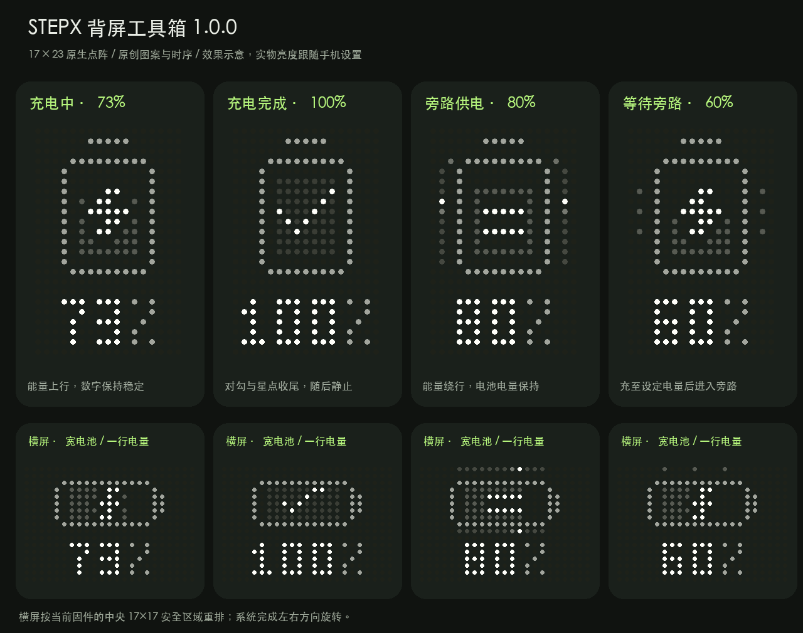
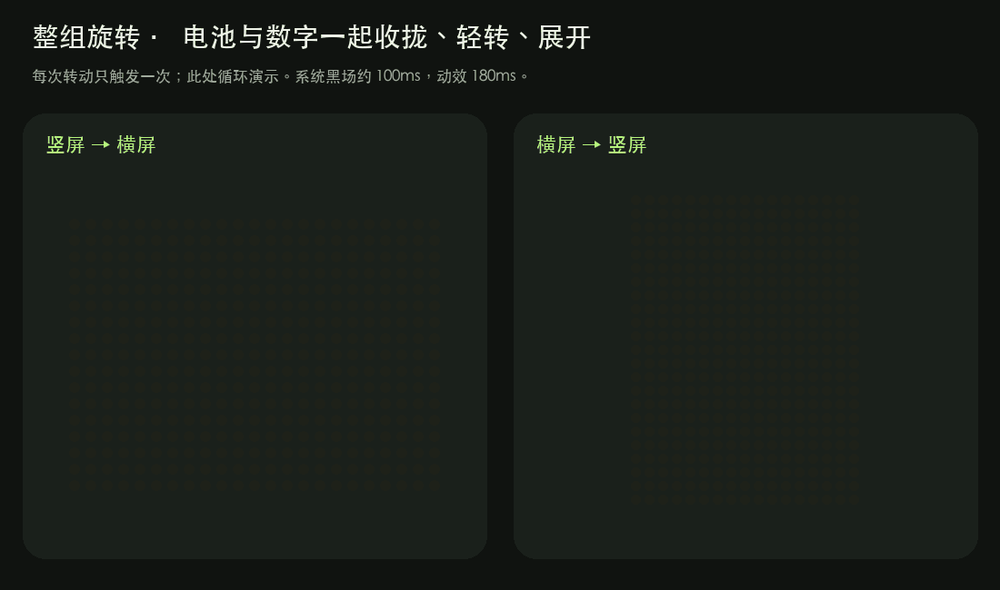

# STEPX 背屏工具箱 · Backscreen Toolbox

[STEPX Advance](https://github.com/stepx-advance) 系列的原生 Android 背屏工具。目前提供充电显示：在 STEPX PZ261A 的点阵背屏上显示真实电量、充电动画、满电和旁路状态，并随握持方向切换布局。

无需 Root 或 Shizuku。离线运行，无网络权限。非官方项目。



## 下载与安装

**1.0.0 安装包目前保留在发布草稿中，等待锁屏、背屏朝上时的实物显示确认，尚未开放下载。** 公开后可从 [Releases](https://github.com/stepx-advance/backscreen-toolbox/releases) 下载 `backscreen-toolbox-1.0.0.apk`，使用 `SHA256SUMS` 核对文件；首版将标为预发布版。

1. 在 PZ261A 上安装 APK，允许系统安装确认。
2. 打开“STEPX 背屏工具箱”，按一屏设置清单完成后台设置；每个条目都有红框图解和系统设置入口。
3. 开启充电背屏。旁路识别和通知栏显示均可跳过。

**从内部版“背屏充电”迁移：** 先关闭旧版的“自动显示充电状态”，再开启新版，避免争用背屏。新版包名是 `com.stepxadvance.backscreentoolbox`，与旧版 `local.stepx.backcharge` 独立安装；保留原签名，但设置及授权不能自动迁移，需要重新完成。确认新版可用后可自行卸载旧版。

## 功能

| 状态 | 背屏显示 |
| --- | --- |
| 正在充电 | 电池、闪电和上行能量，电量数字保持稳定 |
| 系统确认充满 | 对勾和短暂星点，随后静止显示真实电量 |
| 旁路生效 | 能量绕过电池，保留真实电量 |
| 等待旁路生效 | 按当前充电状态显示，并附等待标记 |
| 接电但暂停充电 | 暂停符号与电量 |
| 拔掉充电器 | 交还系统原来的背屏内容 |

竖屏按 17×23 排版；横屏针对当前固件的中央 17×17 有效区域重排。旋转时图标与电量整组过渡，可单独关闭。方向数据暂时中断时采用紧凑布局并尝试恢复。主屏熄灭后保持最后方向，遵循系统背屏规则。

主屏提供实时状态、动画预览和 12 秒实物预览。关闭自动显示会停止服务、取消恢复任务并交还背屏。旁路识别只读取原厂状态信号，**不控制充电硬件**。



## 首次设置

| 清单 | 操作 |
| --- | --- |
| 系统背屏 | 开启“背屏显示”，需要持续显示时选择“始终显示” |
| 后台运行 | 接受系统电池优化确认 |
| 开机与后台恢复 | 应用信息 → 耗电和后台 → 手动管理，开启“允许自启动”和“允许后台运行” |
| 旁路识别（可选） | 允许通知使用权，仅读取系统电池状态通知 |
| 通知栏显示（可选） | 按需开启；拒绝后普通充电显示仍可运行 |

后台管理开关由你核对后保存，应用不能读取这些原厂开关。开机首次解锁后尝试恢复；强行停止、限制后台和系统电源保护可能阻止恢复。前台服务仍向系统提供运行通知；关闭通知权限时通知抽屉不显示，系统“活动应用”仍有运行标识。详见 [设置说明](docs/SETUP.md) 和 [权限与隐私](docs/PRIVACY.md)。

背屏朝下、被双击暂时熄灭或受睡眠/省电/温度策略限制时，即使画面已提交也可能不点亮；请区分系统背屏熄灭与应用停止。

## 兼容性与限制

目前仅验证 **STEPX PZ261A、Android 16 / API 36、Step AOS 1.0.0.2 的测试固件**。最低安装版本为 Android 14，不代表其他设备或 Android 版本已经兼容。背屏接口、旋转和旁路通知依赖原厂固件，OTA 后需重新确认。

AC 旁路从等待到生效的硬件切换、低电量完整充电过程、来电与相机冲突、高温及长期运行尚未完成实机验证。内部版曾通过解锁后开机恢复；更换包名的公开版未重新做重启测试。详见 [验证范围](docs/TESTING.md)。

## 开发

原生 Java，无第三方运行时依赖。需要 Python 3.9+、JDK 17、Android SDK platform 36 / build-tools 36.0.0。

```sh
python3 tools/test.py
python3 tools/build.py
```

默认生成独立开发签名的 `dist/backscreen-toolbox-1.0.0-dev.apk`，不能覆盖官方签名的安装包。正式构建必须显式指定已有私钥，工具不会自动生成“正式签名”。详见 [构建说明](docs/BUILD.md)。

## 反馈与参与

通过 [Issues](https://github.com/stepx-advance/backscreen-toolbox/issues) 提交机型、固件、应用版本和复现步骤。请勿上传设备序列号、账号、完整通知内容或未经检查的原始日志。贡献前请阅读 [CONTRIBUTING.md](CONTRIBUTING.md)。

原创代码、点阵图案与动画采用 [MIT](LICENSE)。系统设置截图和品牌名称见 [NOTICE.md](NOTICE.md)。本项目没有设备厂商的官方认证或背书。
